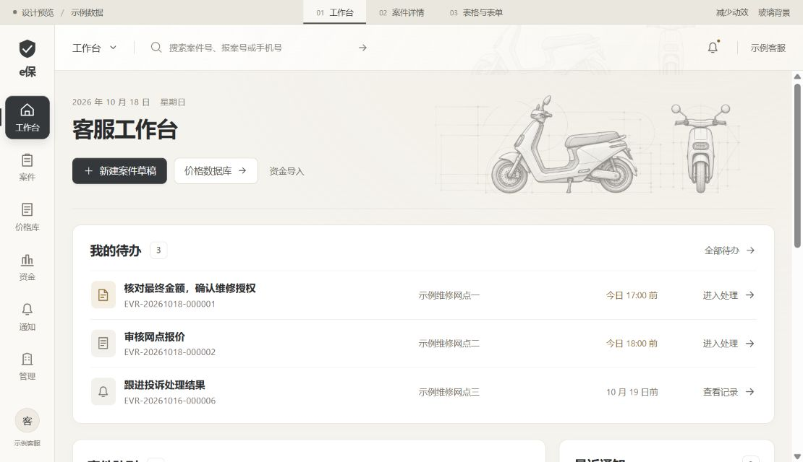
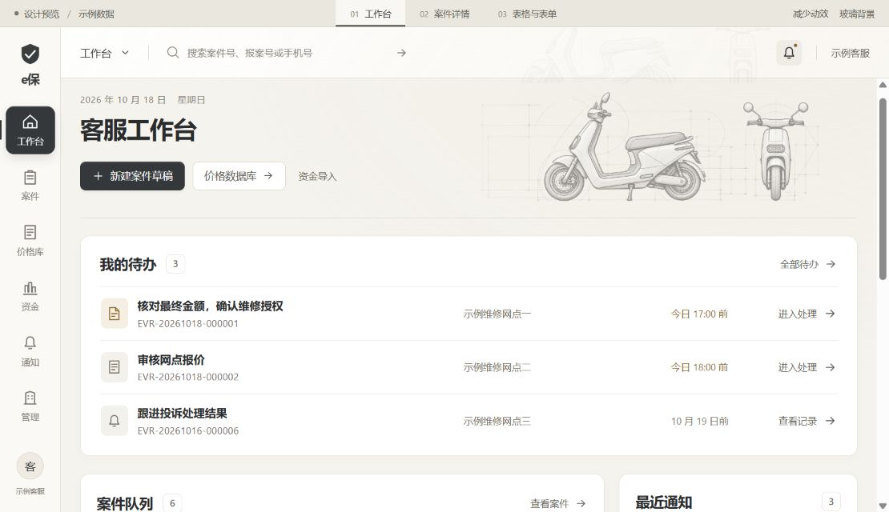
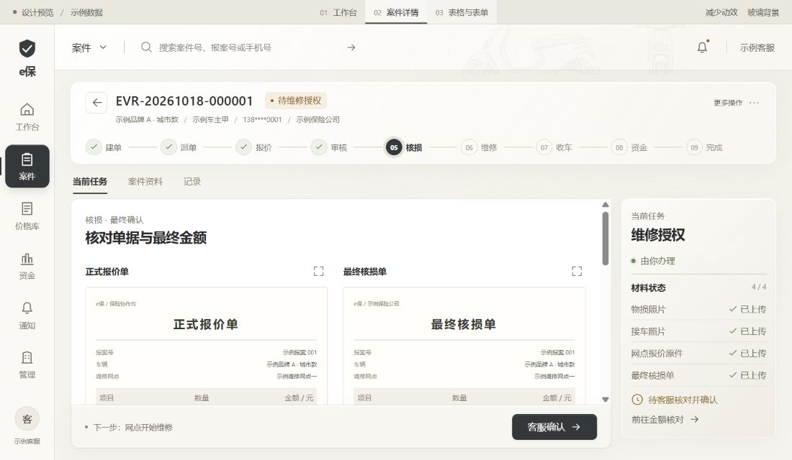
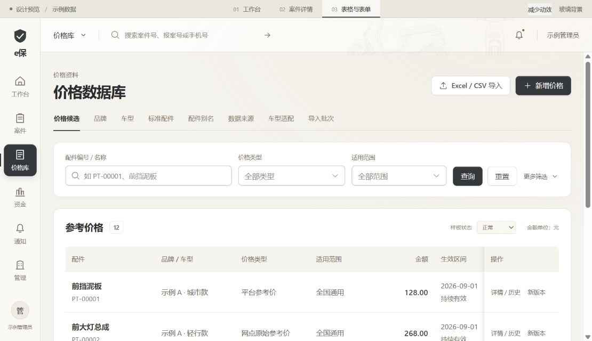
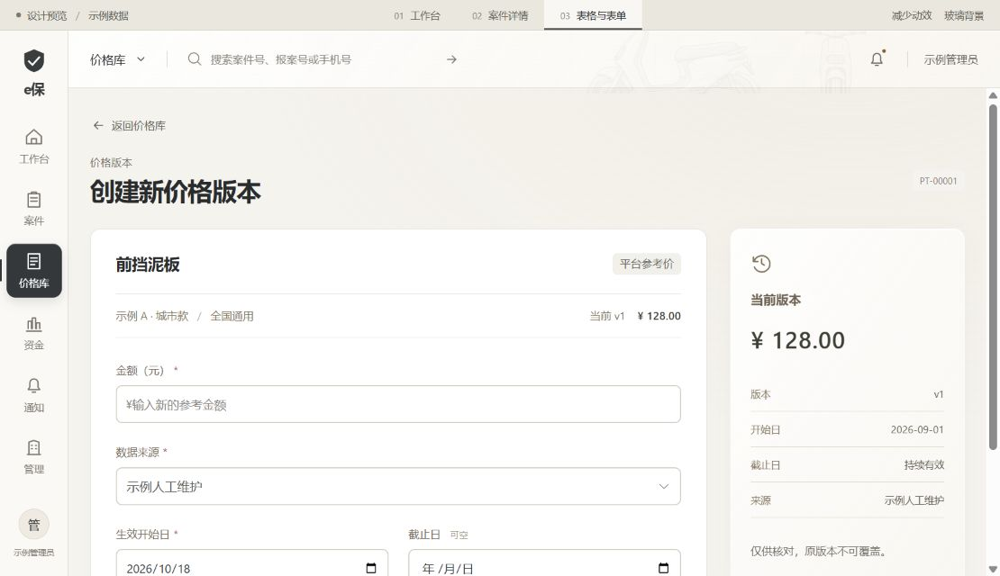

# 客服 / 管理员桌面端 · 三类设计样板

2026-10-18，阶段 B 预览交付，待用户审阅。范围、风格和实施顺序见 [升级计划书](../../FRONTEND_UPGRADE_PLAN.md)。

## 打开与体验

离线文件为本目录的 **preview.html**。请在文件管理器中用 Chrome 或 Edge 打开；图片、样式与脚本已打包到同一个文件，关闭后不会保存演示输入。该产物可按下方命令重新生成，不纳入 Git。

顶部的「01 工作台」「02 案件详情」「03 表格与表单」切换三个样板；「减少动效」「玻璃背景」可比较动效与透明效果。顶部细条是评审工具，不属于正式产品。

| 样板 | 可以体验的内容 | 视觉重点 |
| --- | --- | --- |
| 工作台 | 待办、队列查询、空结果、通知定位、进入示例案件 | 原有快捷入口与信息顺序；精修工程插图；主要待办首屏可见 |
| 案件详情 | 九节点、单据对照与放大、资料/记录切换、金额校验、确认反馈 | 摘要和流程稳定；正文独立滚动；右侧任务与底部操作可见 |
| 表格与表单 | 查询、分页、加载/空/错态、历史弹窗、新版本表单及确认 | 表格局部横滚、固定操作列；旧版本对照；错误就近显示 |

案件演示金额为 **1378.60**，填写后勾选核对项可进入确认。价格表每页 6 条，从任一行「新版本」进入完整表单。

## 设计说明

- 底色 `#F5F3EE`，正文 `#292B2D`，主操作 `#35383B`。成功、待处理和错误继续使用有语义的绿、琥珀和红。
- 磨砂主要用于顶栏、案件摘要、任务栏和浮层；表格、表单与原件阅读区使用实底，保证连续工作时的清晰度。
- 导航和主要操作位置沿用现有结构。留白略微增加，列表保持紧凑；辅助文字移至相应控件附近。
- 页面切换约 180ms、下方内容显现约 300ms；首屏任务不等待逐项动画。支持系统减少动效偏好，并提供评审开关。
- 工程插图保留侧视与正视构图，线条统一为暖石墨色，背景透明，不压住文字。

## 工具与 skills 选择

本项目适合以 **redesign-existing-projects** 为主，结合 **imagegen** 精修工程插图，再用浏览器验证实际页面。已有工具足够完成这一阶段，无需额外安装插件。

保留 Vue 3、TypeScript、Vite 和 Element Plus，直接复用仓库已有依赖。强调营销页大留白、强滚动叙事的 skills 不适合直接主导客服工作界面。当前 design-taste-frontend 的适用范围也不覆盖密集后台表格和多步骤工作流，故本轮未作为主 skill。

插图采用 imagegen 内置编辑，参考原文件 `admin-web/src/assets/e-scooter-blueprint-panorama.webp`，产物 `assets/scooter-graphite.png`。生成要求：保留车辆轮廓、侧视与正视的宽幅构图；精修为清晰的石墨技术线稿与柔和金属灰；减淡辅助制图线；透明背景；不加品牌、文字或标志；保持车体完整。原图未覆盖。

## 截图

截图使用约 1110×640 的浏览器视口，案件详情图为 1100×640；与下方 1280/1366 视口的几何验证分别记录。

### 工作台





### 案件详情



### 表格与表单





## 验证记录

以下命令从仓库根目录执行，均使用已有依赖：

```powershell
# 启动独立预览，仅监听本机
node admin-web/node_modules/vite/bin/vite.js --config docs/design/desktop-upgrade-preview/vite.config.mjs --configLoader native

# 检查与构建
Push-Location docs/design/desktop-upgrade-preview
node ../../../admin-web/node_modules/eslint/bin/eslint.js . --max-warnings 0
node ../../../admin-web/node_modules/vue-tsc/bin/vue-tsc.js --noEmit -p tsconfig.json
Pop-Location
node admin-web/node_modules/vite/bin/vite.js build --config docs/design/desktop-upgrade-preview/vite.config.mjs --configLoader native
node docs/design/desktop-upgrade-preview/package-preview.mjs
```

| 检查 | 实际结果 |
| --- | --- |
| 样板 ESLint | 通过；包装脚本增加后单独复验通过 |
| TypeScript / Vue 类型检查 | 通过；没有放宽生产配置或跳过检查 |
| Vite 构建 | 通过，产物在 `tmp/desktop-upgrade-preview-dist/`；完整引入 Element Plus 使 JS 约 1.02MB，构建保留大包警告，尚未做正式按需加载优化 |
| 工作台交互 | 查询、空结果与清除、跨页搜索、通知定位通过；修复了切换动画中组件尚未挂载导致搜索失效的问题 |
| 案件交互 | 空金额和不一致金额均被拦截；1378.60 + 核对勾选进入确认；确认后状态不变；资料、记录、原件放大/关闭可用 |
| 详情 1280×640 | 右栏 top 278.93 / bottom 612.45；clientHeight = scrollHeight = 332，无内部滚动；操作栏 bottom 624；正文滚动约 486.67 后摘要、右栏和操作栏位置不变 |
| 详情 1366×768 | 右栏 bottom 710.22，操作栏 bottom 747.67，均在窗口内；页面无整体横向溢出 |
| 表格与表单 | 6 条/页翻页、查询回到第 1 页、加载/空/错态和重试通过；空金额报错，139.80 可进入演示保存；原记录不变 |
| 降级 | 评审开关可关闭动效和背景磨砂，实体模式 backdrop-filter 为 none；系统偏好降级有代码支持，未切换系统设置验证 |
| 浏览器日志 | 内置浏览器的 warn/error 检查为空 |
| 离线打包 | 已生成约 3.08MB 的单文件 HTML；提取的内联 JS 经 `node --check` 通过，无外部 script / CSS 引用，插图已内嵌。内置浏览器禁止 file 协议，因此未直接运行离线文件，未尝试绕过该限制。实际交互验收使用本机 HTTP 开发预览 |
| 文本差异 | `git diff --check` 检查本轮已跟踪文档；新增文本逐个执行 `git diff --no-index --check -- /dev/null <文件>`，无空白错误，仅既有 LF/CRLF 提示 |

首轮检查曾发现表格 slot 类型推断问题，以及 lint 扫到 Vite 缓存和 Node 脚本全局变量；已修正类型、明确导入 Node API，仅排除第三方生成缓存后复验通过，没有关闭源码规则。没有为纯布局添加镜像 CSS 的测试。

## 交付边界与下一步

全部数据、单据和金额为合成示例，不连接业务 API；确认、保存仅演示反馈。仅第一条案件有详情样板，其余入口明确说明预览范围。更多筛选展示控件布局，样板仅执行主筛选条件。

本轮没有修改 `admin-web/src`、后端、H5、数据库或业务服务，也未覆盖工作区已有改动。未执行真实业务流程、角色权限、上传导入、跨浏览器、200% 缩放、性能基准或全站回归；未补齐登录后现状截图，因此尚无完整的改前/改后同屏验收。上述项目须在后续对应阶段完成，不能用本次样板检查替代。

本阶段交付三类可审阅样板，临时开发服务在收尾关闭，无发布、提交或推送。请优先评审材质、信息密度、插图大小和动效力度；确认后再进入阶段 C，把认可的样式接入正式页面与基础组件。
