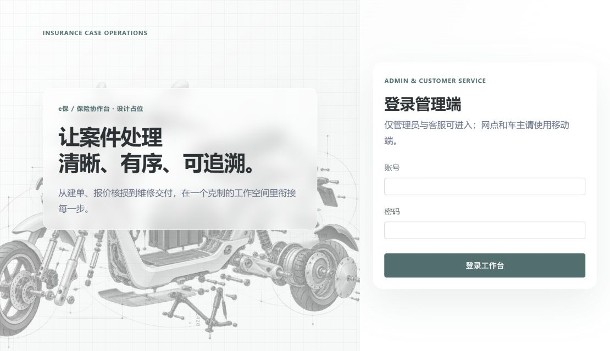
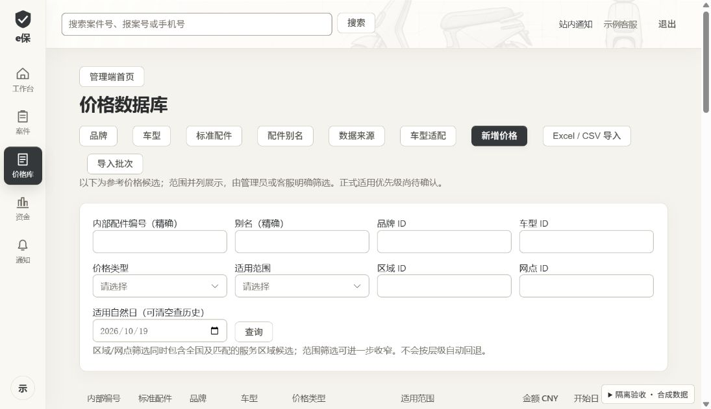
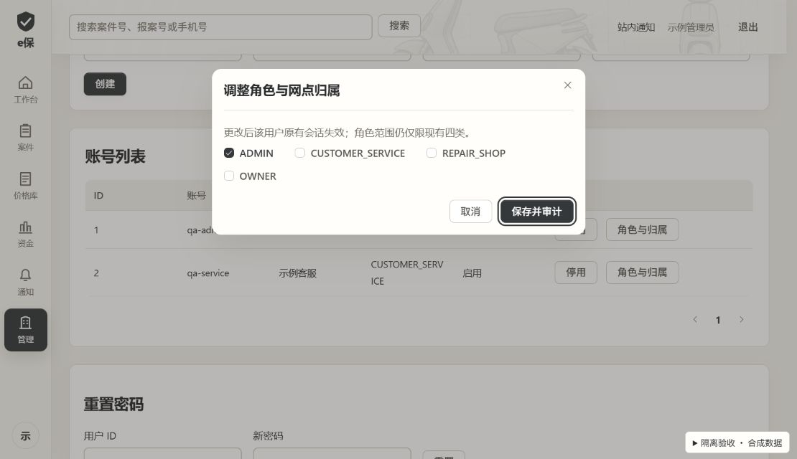

# 桌面端视觉升级 · 阶段 C 交付

日期：2026-10-19。范围：客服／管理员电脑网页版的全局视觉与基础组件，已接入 `admin-web` 正式源码。业务流程、API、路由、角色权限与 H5 不变；未部署。

## 已完成

- 暖白页面底、石墨灰主操作、统一文字和语义色；导航／登录轻玻璃，数据表格与编辑面保持实底。
- 统一按钮、输入、下拉、表格、标签、提示、分页、对话框和焦点；使用 Element Plus 内置简体中文语言包。
- 保持导航宽度、76px 顶栏和原断点；顶栏接入精修石墨插图，取消搜索／登录按钮跟随指针。
- 登录保留工程拆解插图并完整展示，缩短宣传与制作提示；账号密码校验、失败反馈、移动端指引保留。
- 保留减少动效／透明度的样式降级，补充不支持磨砂的实底回退；本阶段未改案件滚动结构。
- 修正管理员角色弹窗中通用 label 样式误作用于复选框的问题，仅缩小样式选择器范围。

## 截图

登录前后均设置 CSS 视口为 1110×640；升级前读取本轮修改前备份，升级后读取正式组件。价格页和管理员弹窗均为正式组件加隔离合成数据，右下角验收工具不进入生产代码。

### 登录升级前

### 登录升级后

### 导航与基础组件

### 管理员弹窗

价格页专用排版及原有说明仍待阶段 E；工作台／案件专用升级属于阶段 D。截图展示当前阶段，不代表全站升级完成。

## 验证结果

以下命令在 `admin-web` 执行，最终源码版本全部通过：

| 检查 | 命令 | 结果 |
| --- | --- | --- |
| ESLint | `npm run lint` | 通过，0 warning |
| TypeScript | `npm run typecheck` | 通过 |
| 现有测试 | `npm test` | 98 项通过，0 失败／跳过 |
| 生产构建 | `npm run build` | 通过，2.98s |
| 差异空白 | 根目录 `git diff --check` | 通过；仅既有 LF/CRLF 提示 |

最终命令日志位于本地忽略目录 `tmp/desktop-upgrade-stage-c/final-*.log`。未新增依赖，未删除测试或放宽检查。既有设计测试只同步新版插图资产名与测试描述。

浏览器使用内置浏览器、本机隔离 HTTP 预览，加载真实 App／路由／页面组件，以独立 client 替换网络层；所有数据合成、所有写入被拒绝：

- 客服隐藏管理员入口；管理员可见管理入口。导航展开、收起及价格页跳转正常。
- 价格查询能筛至单条；加载禁用、空结果和错误提示正常，恢复正常状态可再次查询。
- 新版本表单保留金额校验；有效金额进入原保存确认框，原版本和审计说明保留。未点击最终确认，Escape 可关闭。
- 管理员角色弹窗复选框恢复同行显示；Tab 后焦点仍处于对话框内。未写入角色或账户。
- 登录空值提示、合成登录失败、密码清空和客服登录／退出通过；仅输入测试字符串，未使用真实账号密码。
- 1280×640 登录错误提示和按钮完整可见，页无整体横向溢出；1440×900 外壳保持 76px 顶栏和 174px 模块导航；640×720 登录按原窄屏方向重排，允许纵向滚动、无横向溢出。

色值配对计算：正文／白底 14.21:1、辅助文字／页面底 4.66:1、白字／主按钮 11.80:1、占位文字／白底 4.86:1、成功／浅成功底 5.59:1、警告／浅警告底 4.90:1、错误／浅错误底 5.06:1。这只验证指定色值，不能代替所有玻璃合成背景的对比度审计。

隔离验收初次加载中文语言包时，临时 Vite alias 错误匹配子路径；将 Element Plus alias 限定为包名后恢复。临时工具链仍有 vue-router 旧入口弃用提示，与正式生产构建无关，未将控制台整体记为无警告。

## 边界与后续

本轮没有修改或启动后端、数据库、H5；相关构建、Flyway、Compose 不适用，未执行。浏览器数据是合成数据，未验证真实服务端权限、案件状态变更、上传导入、资金操作或真实业务端到端。既有未提交的业务改动均保留。

未完成跨浏览器、200% 缩放、真实系统媒体偏好切换、全站视觉回归及性能基准；阶段 F 需补齐。当前本地后端运行包与源码差异继续按 PROGRESS 的既有记录处理，本次不升级业务运行环境。

临时验收代码与备份在 `tmp/desktop-upgrade-stage-c/`，不作为生产源码或持久交付；收尾关闭本轮临时服务。下一阶段为 D：工作台、队列、建单、详情九节点、原件对照和滚动体验，依仓库阶段门禁确认后进入。
