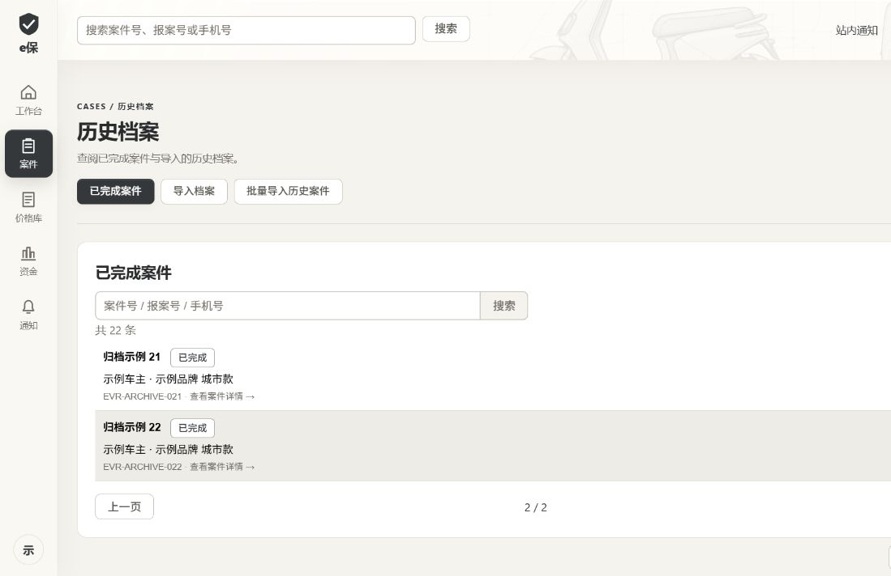

# 登录页配图与已完成案件入口调整

2026-10-19，用户澄清配图指登录页；此前误改的工作台配图已恢复原尺寸。已完成案件仅在历史档案列表展示的调整继续保留。

- 登录工程拆解图高度由容器 44% 改为 50%，宽度 88% 改为 94%，微调定位，保持 contain 完整展示；实际整车线性尺寸放大约 14%。桌面矮窗口略微上移文案，图文不重叠；窄屏原规则保持。工作台图片恢复 `min(820px,68%)` 和原定位。
- 普通队列固定发送现有 `excludeCompleted=true`，过滤发生于服务端分页与计数之前；首页、顶部搜索、重置和旧 URL 均保持该范围。
- 普通队列移除“已完成”状态；旧完成状态 URL 按未选择处理，旧选中完成案件 URL 转到历史档案。历史档案仍按 `COMPLETED` 分页查询、打开原详情，原状态与权限不变。

验证：`admin-web` 下 `npm run lint`、`npm run typecheck`、`npm test`、`npm run build` 全部通过；98 项测试，0 失败／跳过。日志在本地忽略目录 `tmp/home-archive-*.log`。

澄清后的登录调整另执行同四项检查，结果见 PROGRESS；日志 `tmp/login-image-*.log`。1280×640 图片高度 320px（原约 282px），图顶 308px、文案底约 299px，图底 628px，登录按钮底约 505px；1440×900 图片高 450px，均无整体横向溢出。1110×640 截图如上，640×720 保留窄屏重排且无横向溢出。旧 `home.jpg` 仅为已撤回实现的历史截图，不代表当前工作台。

浏览器加载正式组件和路由，以 21 条未完成、22 条已完成合成数据验证：普通列表 20＋1 分页，无已完成；顶部搜索已完成编号无结果；重置恢复 21 条；状态下拉无“已完成”；旧筛选／false 参数仍不显示完成；旧选中完成案件跳至历史档案，历史列表 20＋2 分页。1280×640、1440×900 横幅均为 214px，无整体横向溢出；矮窗口快捷按钮完整可见。浏览器 error 日志为空；临时工具链旧 vue-router 入口弃用提示仍存在。

真实本地后端通过 5173 代理只读验证：`excludeCompleted=true` 共 13 条、无完成状态；`status=COMPLETED` 共 1 条且为完成状态。没有创建或更改案件。后端源码、数据库、H5 未修改，未重复相关构建／迁移。资金与通知的历史追溯、原详情入口保持原业务权限；本次不是全站滚动升级。
