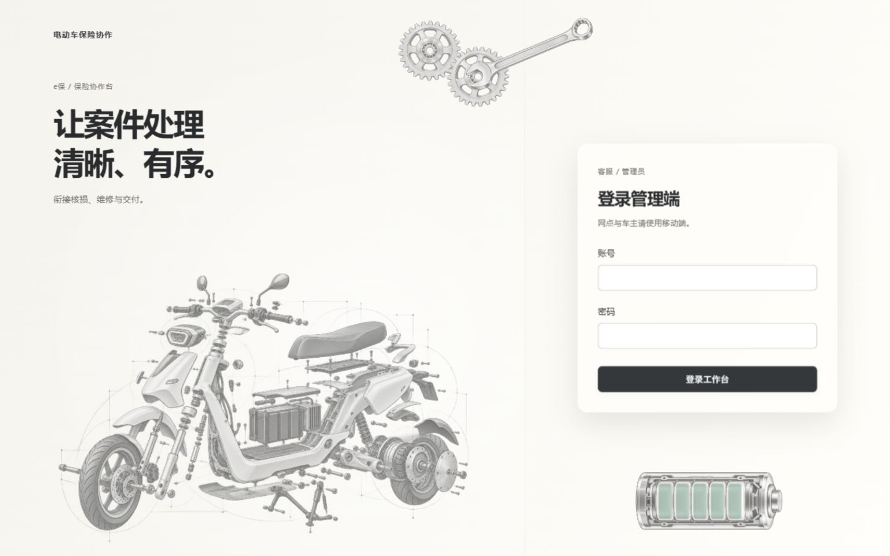
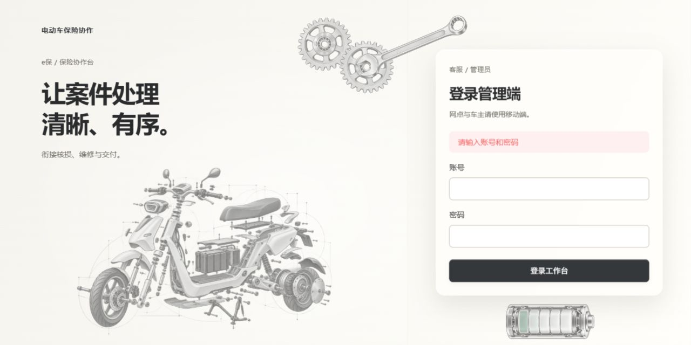
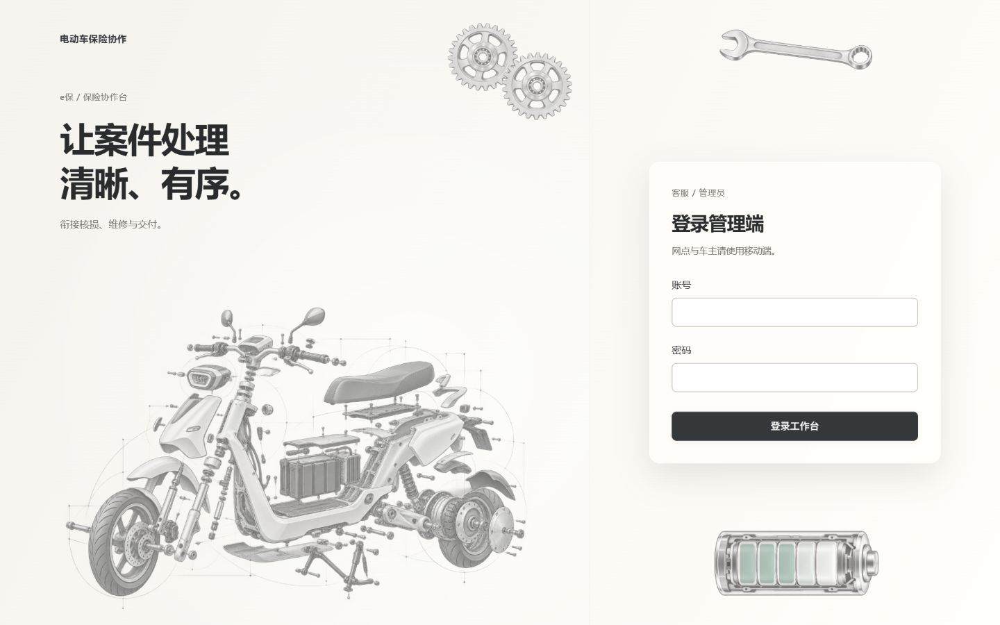
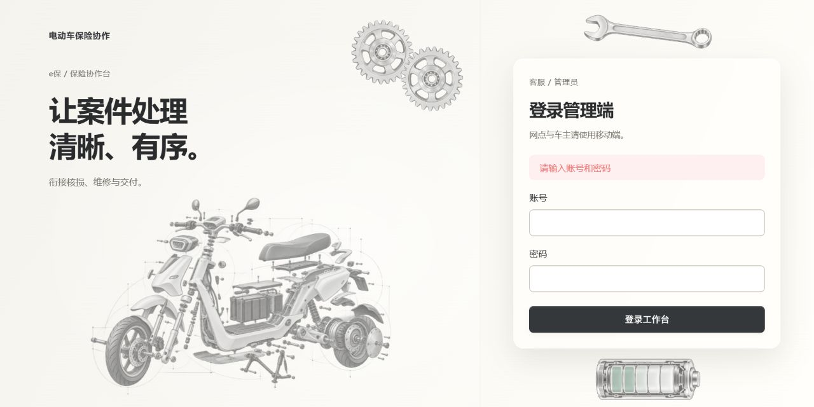
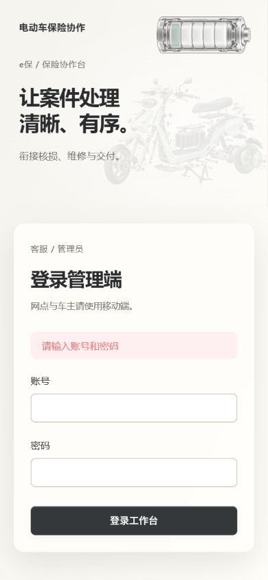

# 登录页金属素材验收

## 最新调整：扳手钳合右侧齿轮

用户要求扳手虎口钳住右侧齿轮，转动时扳手保持静止。复用现有 PNG，将扳手放进同一定位组合，虎口对准右齿轮中心轴，手柄固定斜向右上。只有齿轮应用旋转动画；组合整体等比缩放，窄屏一起隐藏。

浏览器同一视口两次读数确认齿轮矩阵改变，扳手矩阵及边界保持一致，扳手 animation 为 none；见 [wrench-clamp-checks.json](wrench-clamp-checks.json)。900×640、1280×640 错误状态、1440×900 正常状态及390×844窄屏已核对，未出现可见素材遮挡文字／表单或横向溢出。旋转图片的边界矩形包含透明空白，不以矩形相交代替可见像素判断。

本次管理端 lint、类型检查、98 项测试及生产构建通过，未改变登录行为或重新生成图片。此前素材、系统偏好验证和性能限制保持下方记录。

## 初始素材接入记录

2026-10-21，仅客服／管理员管理端。用户提供电池、齿轮和扳手 JPG，并确认齿轮可调整视角、不需要暂停按钮；H5 不变。

- 电池：透明 PNG 横放，正极朝右；五段电芯通过独立 CSS 透明度动画呈现 8 秒充放电循环，充电向右、放电向左回退，外壳静止。
- 齿轮：从原图重建近正面银色独立 PNG，两只相同齿轮分别绕各自中心持续反向转动，周期 28 秒。
- 扳手：透明 PNG 静态展示。三处均不接收指针事件，并从辅助技术阅读内容中隐藏。
- 页面不含暂停按钮；保留系统减少动效偏好下的静态展示规则。窄屏仅保留小电池。

实际管理端页面检查 1280×640、1280×701、1280×761、1440×900、900×640、640×720、390×844。各尺寸含错误提示状态的装饰边界均未与表单卡片相交，未发生横向溢出；640×720 按既有布局纵向滚动，其他实测尺寸可完整显示。几何结果保存在 [layout-checks.json](layout-checks.json)。

浏览器读取到齿轮矩阵及电芯透明度随时间改变；双方周期相同、方向相反、旋转中心均为 54px 54px；扳手动画为 none，暂停按钮数量 0，装饰 pointer-events 为 none。代表性读数在 [motion-checks.json](motion-checks.json)。空输入提示和表单可操作，图片全部成功加载，浏览器控制台 error 为空。截图为静态记录，动效请在本机预览查看。

管理端 lint、类型检查、98 项测试和生产构建通过；最终调整样式后重跑 lint 和构建。日志在本地忽略目录 `tmp/login-metal-*.log`。无新增前端依赖，未修改登录请求／权限判断。

素材由内置 ImageGen 编辑输出，存放在 `admin-web/src/assets/`，详见 [素材与完整提示词](PROMPTS.md)。三张透明 PNG 合计约 4.56 MB；未做弱网性能测试，未实际切换操作系统减少动效偏好，也未进行跨浏览器／物理设备及真实账号登录验收。本轮不包含提交、推送或部署。
